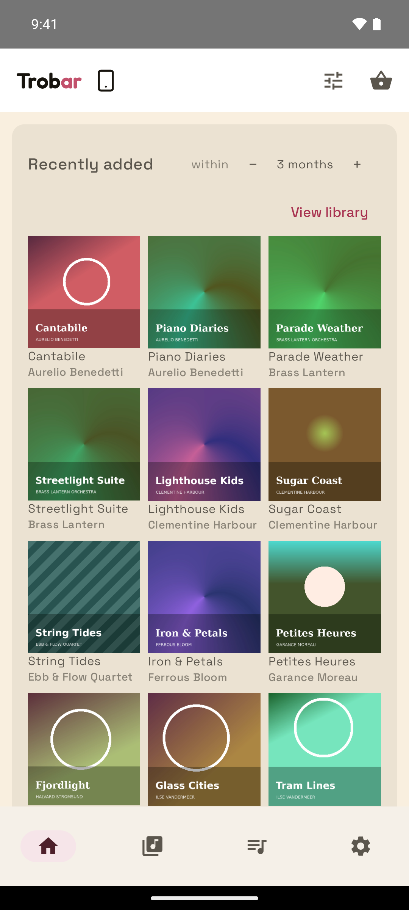
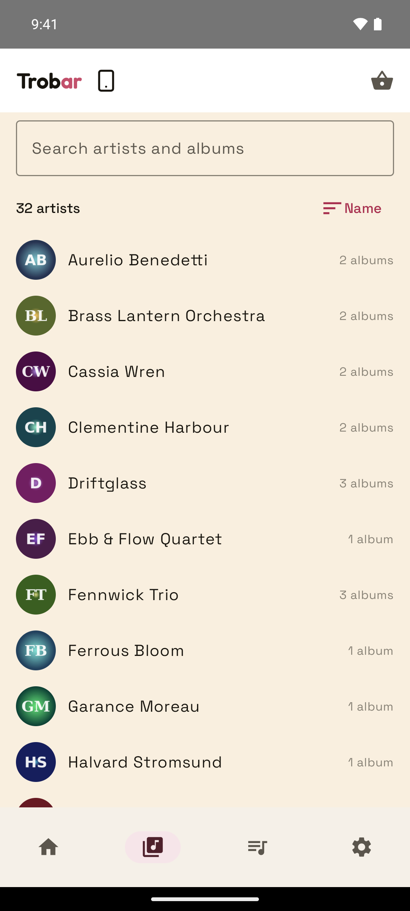
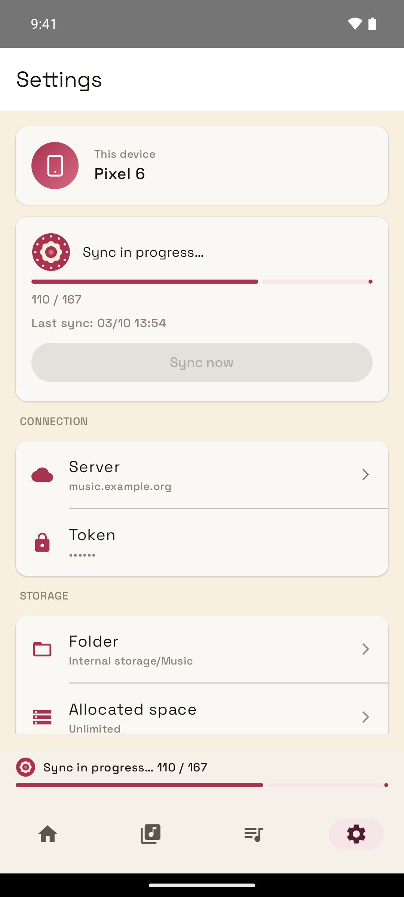
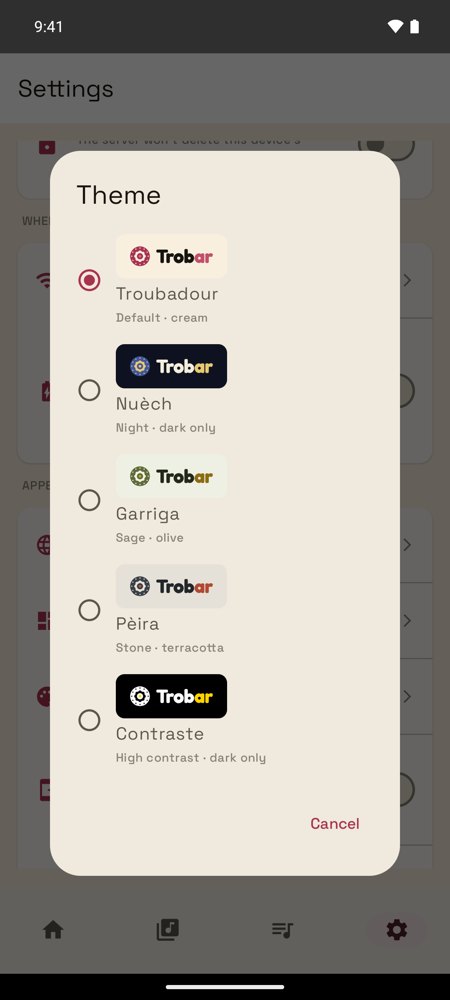
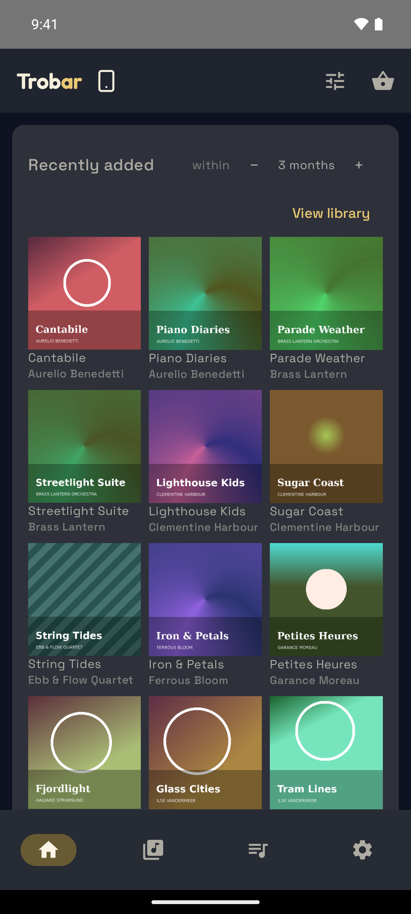
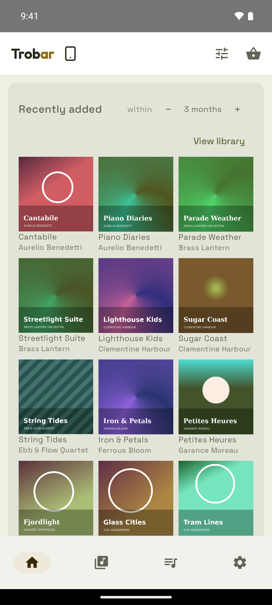
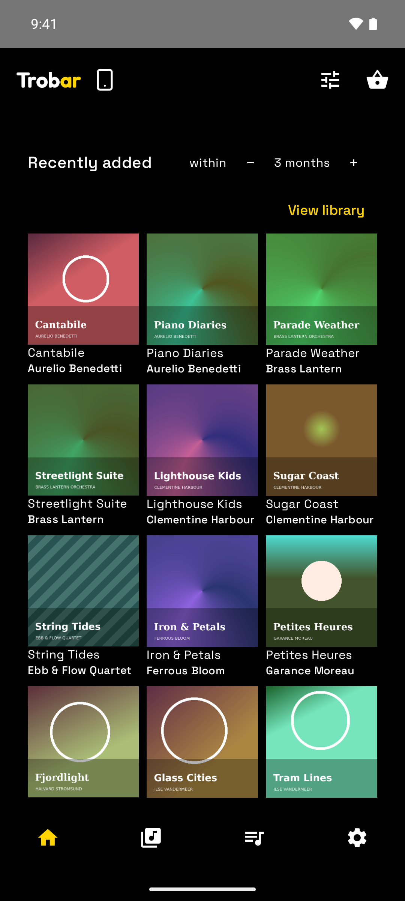
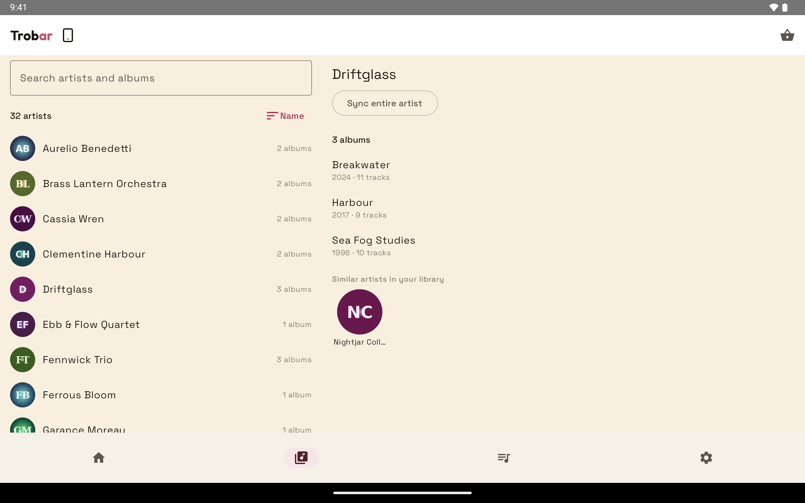

<!--
SPDX-FileCopyrightText: 2026 missing-foss

SPDX-License-Identifier: GPL-3.0-or-later
-->

# Trobar for Android

[](https://securityscorecards.dev/viewer/?uri=github.com/missing-foss/trobar-android)
[](https://ko-fi.com/missingfoss)

The Android client of [Trobar](https://github.com/missing-foss/trobar-server)
— self-hosted music library sync. Pick artists, albums, or playlists in the
web app; this client keeps them offline on the phone, tablet, watch, or
Android-based DAP, in original quality (or transcoded, if the device is set
up that way server-side).

## Screenshots

<p align="center">
  
  
  
  
</p>

<sub>Home · Library · a sync in progress · the five themes. Captured on a Pixel 6
emulator against trobar-server's showcase library: invented artists, albums and
cover art, nothing real or copyrighted.</sub>

<p align="center">
  
  
  
</p>

<sub>A theme recolours the whole app: Nuèch, Garriga and Contraste. More
(enrolment, Playlists, Simple mode) under
[`docs/screenshots/`](docs/screenshots/), with how they were made.</sub>

<p align="center">
  
</p>

<sub>On a tablet, the Library shows the artist list and the selected artist side
by side.</sub>

## Install

**With [Obtainium](https://github.com/ImranR98/Obtainium)** (recommended — automatic updates):
in Obtainium tap **Add App** and paste the repository URL:

```
https://github.com/missing-foss/trobar-android
```

That's the reliable method everywhere. There's also a one-tap button:

[](https://apps.obtainium.imranr.dev/redirect?r=obtainium://add/https://github.com/missing-foss/trobar-android)

**Without Obtainium**: download the APK from
[Releases](https://github.com/missing-foss/trobar-android/releases)
(tags `vX.Y.Z`) and install it.

## A warning you will see after updates

Google's developer-verification requirement is expected to stop sideloaded apps
from installing and running on certified Android devices. Trobar is sideloaded —
both methods above are exactly the distribution path that requirement closes —
so the app shows a notice about it on the first launch after each update, until
the situation changes. The notice comes from
[FreeDroidWarn](https://github.com/woheller69/FreeDroidWarn).

It has three buttons, two of which open a site we do not control:

- **OK** — dismisses it. Nothing is opened, and it stays dismissed until the
  next version.
- **Details** — opens [keepandroidopen.org](https://keepandroidopen.org), a
  campaign site about the requirement.
- **Solution** (red) — opens the
  [FreeDroidWarn README](https://github.com/woheller69/FreeDroidWarn?tab=readme-ov-file#solutions),
  where the library's own author sets out what they suggest doing about it.

## Verifying the download

Release APKs are signed with the maintainer's key. You can confirm any APK
you download is a genuine build by checking its signing certificate:

```
apksigner verify --print-certs trobar-<version>.apk
```

The **SHA-256 of the signing certificate** must be:

```
43:5A:96:63:1D:40:0C:88:EC:AF:63:5A:EA:DD:1F:5B:F7:1F:62:60:D2:9A:61:49:47:36:2D:27:ED:F3:F5:2E
```

Obtainium pins this automatically after the first install and warns you if a
later update is ever signed by a different key.

## Pair

In the Trobar web app, choose **Add a mobile device** and **Generate pairing
code**. Scan the QR code with the app's enrolment screen, or type the server
URL and the code, then pick a sync folder: the app creates its own device on
the server. Full walkthrough:
[the Android client guide](https://missing-foss.github.io/trobar-server/clients/android/)
in the Trobar documentation.

## Icon packs

The launcher entry is one of five aliases, one per brand theme, and exactly one is enabled at a time. An icon pack has to list all five, or it loses Trobar's icon as soon as someone picks another theme. In an `appfilter.xml`, all five point at the same drawable:

```xml
<item component="ComponentInfo{org.missing_foss.trobar/org.missing_foss.trobar.LauncherTroubadour}" drawable="trobar"/>
<item component="ComponentInfo{org.missing_foss.trobar/org.missing_foss.trobar.LauncherNuech}" drawable="trobar"/>
<item component="ComponentInfo{org.missing_foss.trobar/org.missing_foss.trobar.LauncherGarriga}" drawable="trobar"/>
<item component="ComponentInfo{org.missing_foss.trobar/org.missing_foss.trobar.LauncherPeira}" drawable="trobar"/>
<item component="ComponentInfo{org.missing_foss.trobar/org.missing_foss.trobar.LauncherContraste}" drawable="trobar"/>
```

Two drawings of the logo for pack makers:

- [brand/trobar-mark-mono.svg](brand/trobar-mark-mono.svg): the plain logo, one colour, on a 200 grid.
- [docs/icon-pack/arcticons.svg](docs/icon-pack/arcticons.svg): a line icon drawn to [Arcticons](https://github.com/Arcticons-Team/Arcticons)' rules (48 px canvas, 1 px white lines with round caps and joins, 1.5 px dots). It is offered under [CC BY-SA 4.0](LICENSES/CC-BY-SA-4.0.txt), the licence Arcticons uses.

The adaptive icon also has its own monochrome layer, so launchers that theme icons get a clean single-colour Trobar without any pack.

## Build

Standard Gradle project: `./gradlew assembleDebug`. Release builds are
signed with the maintainer's key; to sign your own, set the
`TROBAR_KEYSTORE*` environment variables (see the server repository's
`docs/troubleshooting.md`) — and keep using the same keystore forever,
Android refuses updates across a signature change. Without them,
`./gradlew assembleRelease` builds an unsigned
`app-release-unsigned.apk`, which is what an F-Droid build needs; the
build prints a warning saying so.

## Support

Trobar for Android is free software, like the rest of Trobar. If it keeps your music on your phone, you can [support Trobar on Ko-fi](https://ko-fi.com/missingfoss).

Support pays for test devices, infrastructure and Claude. Mostly, it buys a good coffee and keeps the motivation going for the next projects.

## License

`GPL-3.0-or-later` — see [LICENSE](LICENSE). Contributions are welcome
under the same license; see [CONTRIBUTING.md](CONTRIBUTING.md).

Contributing a translation? See [Translating Trobar](https://missing-foss.github.io/trobar-server/project/translations/).
